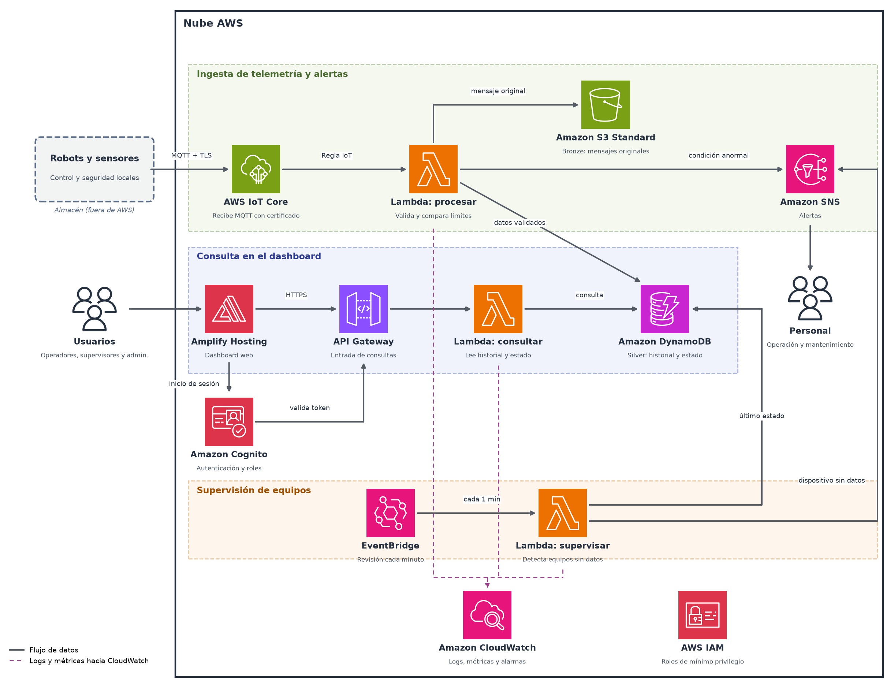

# Arquitectura: supervisión IoT de un almacén en AWS

## Problema y alcance

Supervisar el estado de robots móviles y sensores (posición, velocidad, batería, corriente de motores y estado), conservar historial y generar alertas. El control inmediato del robot y sus funciones de seguridad se ejecutan **localmente**; la nube se usa para supervisión, historial y análisis.

## Diagrama

Fuente editable: [`diagrams/arquitectura-aws-iot.pptx`](diagrams/arquitectura-aws-iot.pptx). Los íconos son los AWS Architecture Icons oficiales.

## Flujos

1. **Ingesta.** Los robots publican telemetría por MQTT con TLS en `almacen/robots/<id>/telemetria`. Una regla de IoT Core invoca la Lambda de procesamiento, que guarda el mensaje original en S3 (**Bronze**), escribe el registro validado en DynamoDB (**Silver**) y publica alertas en SNS si la batería es baja o la corriente es anormal.
2. **Consulta.** Los usuarios acceden al dashboard (Amplify), se autentican con Cognito y API Gateway valida el token antes de invocar la Lambda de consultas.
3. **Supervisión.** EventBridge activa cada minuto la Lambda de supervisión, que avisa por SNS cuando un dispositivo lleva más de 60 s sin reportar.

> Estado actual del repositorio: están implementados en IaC los flujos de **ingesta** y **supervisión** (IoT Core, Lambda, S3, DynamoDB, SNS, EventBridge, IAM, CloudWatch). El flujo de **consulta** (Amplify, Cognito, API Gateway y la Lambda de consultas) está diseñado y documentado, pero aún no incluido en la plantilla.

## Modelo de datos (DynamoDB)

| Atributo | Descripción |
|---|---|
| `device_id` (partition key) | Identificador del dispositivo |
| `sk` (sort key) | `<ts>#<event_id>` para el historial, o `LATEST` para el último estado |
| `ts`, `event_id` | Fecha UTC (ISO 8601) y UUID del mensaje; el `event_id` evita duplicados |
| `x`, `y`, `speed_mps`, `battery_pct`, `motor_current_a`, `state` | Mediciones |
| `last_ts`, `alerted` | Solo en `LATEST`: última recepción y si ya se avisó la desconexión |

## Seguridad

- Cada dispositivo usa un certificado propio y una política de IoT Core limitada a sus tópicos.
- Roles IAM separados por función, con acceso solo a los recursos necesarios.
- S3 con cifrado, bloqueo de acceso público y política que exige TLS; DynamoDB cifrado.
- Sin VPC ni Security Groups en esta versión (ADR 0005).

## Requerimientos no funcionales y cómo se atienden

| Requerimiento | Medida en el diseño |
|---|---|
| Disponibilidad objetivo 99.9 % | Servicios administrados y regionales; sin servidores propios |
| Recuperación ante fallos | Buffer local de 30 min en el dispositivo (ver `device_sim_TX_RX.py`); `event_id` para evitar duplicados; datos atrasados no reemplazan el último estado |
| Observabilidad | Logs con retención de 30 días, alarma de errores y supervisión de dispositivos sin datos |
| Control de costos | Pago por uso, ciclo de vida de S3, retención de logs; alertas en AWS Budgets (a configurar en la cuenta) |

## Limitaciones conocidas

- La supervisión se ejecuta cada minuto, por lo que una desconexión puede avisarse hasta ~2 min después del último mensaje. Un límite estricto de 60 s requeriría los eventos de ciclo de vida de IoT Core.
- La capa **Gold** (métricas de rendimiento y productividad) está pendiente de implementar.

## Decisiones

Ver [`adr/`](adr/README.md).
